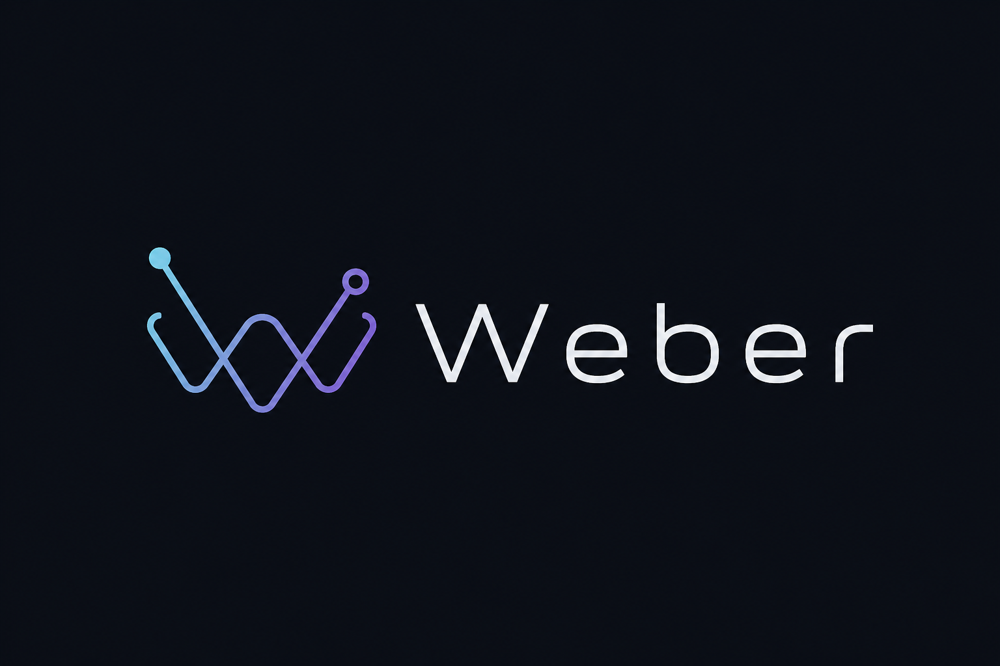

<p align="center">
  
</p>

<h1 align="center">Weber</h1>

<p align="center">
  <strong>Web interfaces. Native desktop applications.</strong><br>
  A desktop application framework built with Rust, Servo and the tools you already use.
</p>

<p align="center">
  <strong>Developer preview</strong> · Linux / Wayland · SDK 0.5.0
</p>

<p align="center">
  <a href="#get-started">Get started</a> ·
  <a href="examples">Examples</a> ·
  <a href="#documentation">Documentation</a> ·
  <a href="docs/beta-plan.md">Roadmap</a> ·
  <a href="LICENSE">License</a>
</p>

---

Weber lets you build desktop interfaces with **HTML, CSS and JavaScript/TypeScript**.
Vite handles development and bundling; Servo renders the interface inside native
windows owned by a Rust host. The runtime has no Electron or Chromium dependency.

The goal is a general-purpose GUI framework for applications of every size,
including future desktop shells. Development currently focuses on a working
Linux foundation, web compatibility, responsiveness and resource use.

## What works today

| Area | Available in the current prototype |
| --- | --- |
| Web UI | Vite, SolidJS, TypeScript, development HMR, CSS animation and `requestAnimationFrame` |
| Windows | Multiple windows for the same app, titles, resizing, maximize, fullscreen and state subscriptions |
| Storage | App-scoped directories and asynchronous persistent JSON storage shared across app windows |
| Clipboard | System text clipboard through the SDK and Servo's standard copy/cut/paste in textarea/input controls on focused Wayland windows |
| Text files | Desktop file chooser, UTF-8 open/save and cancellation through `@weber/sdk/files` |
| App lifecycle | Visible script errors and async close decisions for unsaved changes |
| Backend | Optional Bun process with named calls, subscriptions, cancellation and bounded IPC |
| Distribution | Local npm SDK/runtime packages and relocatable Linux application bundles |

**Platform status:** Linux x64 on Wayland is the implemented and tested target.
Windows and macOS are planned. Weber is a developer preview, not a released beta;
the SDK and runtime packages are not published to npm.

Contenteditable editing, accessibility and broader platform integration remain
on the [beta roadmap](docs/beta-plan.md). Clipboard and text files support
256 KiB UTF-8; app-store values support 1 MiB encoded JSON with a 16 MiB area
quota. File choosers receive the calling Wayland window through xdg-foreign
when the compositor supports it. See the [Linux foundation increment](docs/linux-foundation-05.md)
and the preceding [preview milestone](docs/linux-preview-milestone.md). Browser compatibility is measured
against a [selected, locked test profile](docs/compatibility-target.md), rather
than assumed to cover every web API or arbitrary Electron applications.

## Get started

### 1. Build Weber

Use a Linux Wayland session. Building from source requires Rust/Cargo, a C/C++
toolchain, CMake/Ninja, Git, Python 3, pkg-config, Node.js and pnpm, together with
Servo's graphics and font development dependencies, including Wayland/EGL,
OpenGL, fontconfig and FreeType. Linux packaging also requires `patchelf`.
Bun is needed only for apps that use a Bun backend.

```sh
git clone https://github.com/Hunter2030ZeRo/Weber.git
cd Weber
bash scripts/bootstrap.sh
bash scripts/run.sh
```

Bootstrap fetches the pinned Servo source, applies Weber's patches, installs the
UI dependencies and builds the JIT host. The first build compiles a browser
engine and takes time. The launcher opens an embedded interaction demo without
a development server.

### 2. Create an application

From the Weber checkout, create a Notes app in a sibling directory:

```sh
node sdk/cli.mjs init ../weber-notes notes
cd ../weber-notes
npm install
npm run dev
```

This opens the app in a native Weber window connected to Vite. Edit
`src/main.tsx` or its stylesheet to see updates through HMR. Stop development
before running the next commands:

```sh
npm run check
npm run build
npm start
```

| Command | Result |
| --- | --- |
| `npm run dev` | Vite development server and a native app window |
| `npm run check` | TypeScript validation |
| `npm run build` | Compiled JavaScript, CSS and app manifest in `dist/` |
| `npm start` | Run the compiled app with the native host |
| `npm run package` | Bundle the compiled app and a prepared native runtime in `package/` |

Templates: [`solid`](examples/solid) · [`dom`](examples/dom) ·
[`notes`](examples/notes) · [`node`](examples/node) · [`windows`](examples/windows).
The `windows` template demonstrates multiple app windows; it is not a Windows OS port.

### 3. Package for distribution

Build a release host and prepare its private libraries from the Weber checkout,
then package the app. The following continues from `weber-notes` above:

```sh
cd ../Weber
cargo build --release --locked
python3 scripts/package.py --profile release --output target/package/weber
export WEBER_HOST="$(pwd)/target/package/weber/weber"

cd ../weber-notes
npm run package
./package/weber --app ./package/application
```

The bundle contains the native executable, private libraries, notices and app
resources. A JIT app without a backend runs without Node.js, npm or Bun installed.
A compatible system glibc loader, Wayland compositor, GPU/EGL drivers and fonts
are still required; this is not a universal Linux binary.

The SDK can also be installed independently of the source checkout using local
tarballs. See the [npm distribution guide](docs/npm-distribution.md) for creating
and installing the SDK and platform runtime packages.

## Runtime choices

| Runtime | Role | Status |
| --- | --- | --- |
| **SpiderMonkey** | JavaScript execution and Servo DOM integration | Default JIT path; the normal host excludes Hermes |
| **Bun** | Optional backend for Node.js-oriented code | Separate app-owned process; compatibility depends on the APIs and packages used |
| **Static Hermes** | Native AOT compilation of app logic | Experimental, opt-in source toolchain; further integration is deferred |

The current Hermes path still uses a SpiderMonkey adapter to reach Servo's DOM.
It does **not** replace Servo's JavaScript engine or provide a Hermes-only DOM.
Existing measurements have not demonstrated a startup and memory advantage over
the JIT host. See the [AOT performance gate](docs/beta-plan.md#aot-product-gate)
and [measured comparison](docs/beta-foundation-validation.md).

## Validation

The local npm workflow has been exercised outside the source checkout, including
installation, type checking, builds, packaging and relocation. Native tests ran
the Notes app in isolated GNOME Wayland windows and checked programmatic input,
Save/Reload, a second window, persistence across restart and Vite HMR. These tests
do not establish physical keyboard/IME behavior, Windows/macOS support or
clean-machine compatibility.

The recorded compatibility milestone covers **1,474 selected WPT subtests** from
17 locked upstream files and 15 application scenarios. The
[profile report](docs/profile-validation.md) identifies the tested engines and
builds; it is not a whole-browser conformance score.

Performance results include their workload and build identity. Current work
targets idle activity, small-DOM scheduling and window lifetime; no blanket
memory or startup advantage over Electron or native GUI frameworks is claimed.

## Documentation

| Topic | Guide |
| --- | --- |
| Build tools and SDK | [Vite workflow](docs/vite-workflow.md) · [Local npm distribution](docs/npm-distribution.md) |
| Native windows | [Runtime and ownership](docs/native-runtime.md) · [Window controls and validation](docs/platform-validation.md) |
| Persistent data | [Storage API and Notes example](docs/app-storage.md) |
| Clipboard | [Native text clipboard API and validation](docs/clipboard.md) |
| Files and lifecycle | [Text files, close decisions and diagnostics](docs/files-and-lifecycle.md) |
| Linux preview | [Document and lifecycle foundation](docs/linux-foundation-05.md) · [Initial acceptance](docs/linux-preview-milestone.md) |
| Optional backend | [Bun integration](docs/bun-backend.md) · [Backend validation](docs/bun-backend-validation.md) |
| Web compatibility | [Locked test profile](docs/compatibility-target.md) · [Profile validation](docs/profile-validation.md) |
| Performance | [JIT foundation results](docs/foundation-validation.md) · [CPU investigation](docs/jit-cpu-analysis.md) |
| Project direction | [Beta plan](docs/beta-plan.md) · [Architecture](docs/architecture.md) |

Builds pin Servo to `aac43a3f31a259f04a574f5ec4e959c943ad7cc7` (v0.7.0).
`Cargo.lock` and `app/pnpm-lock.yaml` pin resolved native and UI dependencies;
tracked patches document Weber's engine extensions. Generated files, engine
checkouts, local test artifacts and compiled packages are excluded from Git.
